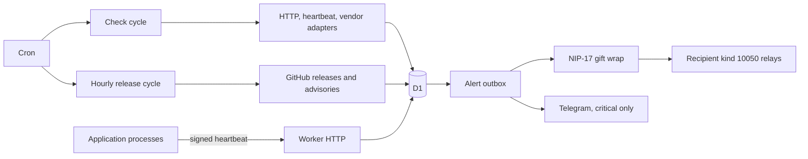

# Architecture

Nostr Watchdog is one Cloudflare Worker and one D1 database per environment. A project is a name, a sender key, and a set of monitors. The check loop, incident policy, and delivery path are the same for every project.

The minute cron runs due probes. The hour cron reads upstream releases and GitHub Security Advisories for monitors that declare a vendor. Both take a D1 lease so an overlapping invocation does not double-send. One failed probe is recorded for that monitor. The others still run.

## State

A check updates `monitor_state` with a generation compare-and-swap. Opening or closing an incident, and inserting the alert rows, happen in the same D1 batch and are conditioned on that new generation. `incidents` allows one open row per monitor and incident kind, so a confirmed outage and a monitoring-integrity warning can both be open. `alert_outbox.dedupe_key` is unique. A lost race does not open a second incident of the same kind or a second copy of the same alert.

Delivery is at least once, not exactly once. A gift wrap uses a random key, so the signed event is stored on the outbox row before the first publish and a retry sends that same event id. A claim token fences the row: an expired claimant cannot overwrite a newer claim. The default claim is 120 seconds and is extended before discovery and publication. Relay `OK` means the relay accepted the event. It does not mean a person or a phone received it. States are `queued`, `relay_accepted`, `retrying`, and `failed`. Partial acceptance stays `relay_accepted` with `partial_relay_acceptance` and records which relays accepted.

## Incidents

The default is two consecutive failures to open and two consecutive successes to close. `down` uses the monitor severity. `degraded` opens a warning incident only when that monitor sets `incidentOnDegraded`. `misconfigured` opens a warning on the first sample. `unknown` does not move the success or failure counters and does not close an outage. After `UNKNOWN_THRESHOLD` consecutive unknown samples, default 5, the Worker opens one warning `inconclusive` incident and keeps updating its reason. A later conclusive sample closes that integrity incident and does not, by itself, close an outage. A skipped check is not a success. Skips happen when a monitor is disabled, its interval has not elapsed, or another run holds the lease. One monitor or vendor failure does not stop the others. Alert delivery still runs when the check lease is already held.

Critical outage reminders use `CRITICAL_REMINDER_SECONDS`. The staging and production templates set four hours. `0` disables them. Reminders are not sent for warning incidents, acknowledged incidents, or incidents inside a silence window. A confirmed vulnerability repeats on the same interval until the finding clears. A partial GitHub result does not refresh the last complete security check, and one source that stays down past the grace period makes `/v1/status` degraded. Disabled monitors stay in the database and do not affect that status.

## Notifications

Each project has its own sender secret and contact name. NIP-17 encryption and gift-wrap construction come from `nostr-tools` (`wrapEvent` / `unwrapEvent`). This Worker does not implement NIP-44 itself.

Inbox relays are the `relay` tags on the recipient's kind `10050` event. Discovery queries the configured bootstrap relays and, when a previous inbox list is stored, those inbox relays too. It verifies each event id and signature with `nostr-tools` and keeps the newest valid replaceable event. A fresh cache is used until it expires. An expired positive list is kept only as a place to look for a newer event, and expired empty results are deleted. A copied event that still carries `nostr-tools`' verification cache is re-checked from its fields. Gift wraps are not sent to the bootstrap relays, to kind `10002` relays, or to any URL that is not `wss` on port 443. The Workers fetch upgrade uses `https://` for that same host. `ws://` is rejected. If every queried relay answers and none has a valid inbox, delivery fails with `recipient_inbox_missing`. A timeout or a relay error is retried. It is not treated as an empty inbox.

Telegram is optional and only for critical incidents. When a bot token and a per-project chat id are set, `TELEGRAM_CRITICAL_MODE=dual` sends Telegram alongside NIP-17 from incident creation. `nostr_fallback` sends one Telegram message after the first critical NIP-17 failure. Later Nostr retries reuse the same dedupe key and do not send Telegram again. A missing Telegram token is `telegram_unavailable` and does not get recorded as delivered. A Telegram failure does not stop the Nostr send.

## Vendor adapters

`alby_hub` calls `GET /api/info`, `GET /api/health`, and `GET /api/node/status`. Info is not proof of node health. Health and node status require a read-only token. The shared cloud origin requires a routing profile and hub name headers. An unknown alarm or a body that does not match the expected fields is `unknown`, which neither clears an incident nor opens a critical one.

`btcpay` calls Greenfield `GET /api/v1/health`. Server info is requested only when a separate read-only key is configured, using the `token` authorization scheme. Public health alone is `degraded` with `coverage_incomplete` when the server is synchronized, because version and processor status were not checked. The check does not create invoices. Chain metadata is not copied into alerts.

Release checks compare an observed version with the latest stable GitHub release for `getAlby/hub` or `btcpayserver/btcpayserver`. Confirmed impact also comes from GitHub Security Advisories and from `src/updates/vendor-policy.ts`, which records official vendor ranges that advisories do not cover. BTCPay Server 2.4.2 and the November 2026 incident affecting 2.4.1 and earlier are in that file. A security-related release without a verified range, including the 2.4.7 security fixes when the installed version is older, is `review_recommended`, not `affected`. An empty advisory list is not a claim that the software is secure. A missing installed version is `version_unavailable` and is not reported as healthy.

## Shipped monitors

`src/config/projects.ts` and `src/config/monitors.ts` define SmartFlowSocial and NostrMash, including Blossom, Blastr, Alby Hub, BTCPay, and the optional read and publish gateways. Every enable flag defaults to false. These definitions are configuration, not a claim that a deployment exists or that a live probe has succeeded. Add another project by extending those two files and the Wrangler vars. The incident, schedule, and delivery code stays the same.
