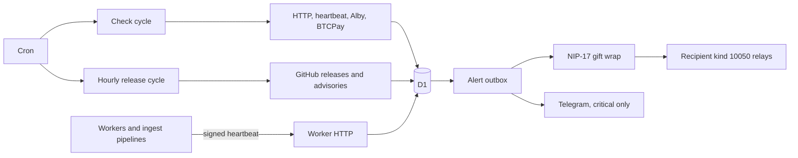

# Architecture

Nostr Watchdog is one Cloudflare Worker, one D1 database per environment, and a project-scoped check engine. It is not a SmartFlowSocial customer-notification implementation, and it does not publish or cache Nostr traffic for the applications it monitors.

A minute cron runs due probes. An hour cron reads upstream releases and GitHub Security Advisories. Both take a D1 lease so an overlapping invocation does not double-send. Each probe is isolated: one failure is recorded for that monitor and the others still run.

## State

A check updates `monitor_state` with a generation compare-and-swap. Opening or closing an incident, and inserting the alert rows, are in the same D1 batch and are conditioned on that new generation. `incidents` allows one open row per monitor. `alert_outbox.dedupe_key` is unique. A lost race therefore does not open a second incident or a second copy of the same alert.

Delivery is at least once. The gift wrap is random, so the signed event is stored on the outbox row before the first publish and the same event is what a retry sends. Relay `OK` means the relay accepted the event. It does not mean a person or a phone received it. States are `queued`, `relay_accepted`, `retrying`, and `failed`.

## Incidents

The default is two consecutive failures to open and two consecutive successes to close. `down` uses the monitor severity. `degraded` opens a warning incident only when that monitor sets `incidentOnDegraded`. `misconfigured` opens a warning on the first sample. `unknown` does not move the success or failure counters and does not close an incident. A check that is skipped because the monitor is disabled, the interval has not elapsed, or another run holds the lease is not a success.

Critical outage reminders are off unless `CRITICAL_REMINDER_SECONDS` is set. Reminders are not sent for warning incidents, acknowledged incidents, or incidents inside a silence window.

## Notifications

Each project has its own sender secret and contact name:

| Project         | Secret               | Contact name             |
| --------------- | -------------------- | ------------------------ |
| SmartFlowSocial | `SFS_BOT_NSEC`       | SmartFlowSocial Watchdog |
| NostrMash       | `NOSTRMASH_BOT_NSEC` | NostrMash Watchdog       |

NIP-17 encryption and gift-wrap construction come from `nostr-tools` 2.26.1 (`wrapEvent` / `unwrapEvent`). The Worker does not implement NIP-44 itself. Inbox relays are the `relay` tags on the recipient's kind `10050` event, discovered through `BOOTSTRAP_RELAYS` and cached. Gift wraps are not sent to the bootstrap relays, to kind `10002` relays, or to any URL that is not `wss` on port 443. If every bootstrap relay answers and none has a valid inbox, delivery fails with `recipient_inbox_missing`. A timeout is retried rather than treated as "no inbox".

Telegram is optional and only for critical incidents. When `TELEGRAM_CHAT_IDS` and `TELEGRAM_BOT_TOKEN` are set, the default `TELEGRAM_CRITICAL_MODE=dual` sends Telegram alongside NIP-17. `nostr_fallback` sends Telegram only after a NIP-17 attempt fails. A Telegram failure does not stop the Nostr send.

## What was verified before these templates existed

These notes are from the local checkouts inspected while the templates were written. They are not live probe results.

- SmartFlowSocial app readiness is `GET /healthcheck`. With `Accept: application/json` the body includes `status: "ok"`. That check covers the app database count and a local HEAD. It does not prove the BullMQ worker, Blossom, or Blastr.
- The SmartFlowSocial worker is a long-running Node process. It has queue metrics and no watchdog heartbeat yet.
- SmartFlowSocial v1.0.0-rc.1 publishes and reads Nostr inside the app. The separate read and publish gateway repositories are not current production dependencies, so this Worker does not monitor them.
- Blossom exposes `GET /health` and `GET /ready`. Ready means the JSON `status` is `ready`. A historical host was documented as `blossom-api.smartflow.social`; it is not hardcoded here.
- Blastr exposes `GET /health` and `GET /ready`. Its production route in the Blastr Wrangler config was commented out, so the public hostname is unverified. The template stays disabled and is warning severity.
- NostrMash `GET /health` is process liveness (`status: "ok"`). `GET /ready` is `ready` only after Postgres answers within two seconds, otherwise `503`. The public API hostname was not confirmed, and the web app had no confirmed readiness route, so there is no web monitor.
- NostrMash ingestor, worker, and trust worker are separate processes. None of them emit a watchdog heartbeat yet.
- Alby Hub's public docs page returned HTTP 500 during implementation. The adapter follows `getAlby/hub` `http/http_service.go` and `api/models.go` on the default branch at that time: `GET /api/info` is public, and `GET /api/health` plus `GET /api/node/status` require a JWT. Read-only unlock is `hub-cli unlock --permission readonly`. `https://my.albyhub.com` is the shared cloud origin and needs `AlbyHub-Name` plus optional `AlbyHub-Region`.
- BTCPay Greenfield `GET /api/v1/health` is anonymous and returns `{ "synchronized": boolean }`. `GET /api/v1/server/info` uses `Authorization: token <key>`, not Bearer.

## Deviations

- Security status is never the word "secure". An empty advisory list is `no_published_advisories`. A parsed range that does not include the installed version is `outside_published_ranges`. A feed failure is `unknown`, or the previous cached judgment when one exists.
- Version notices use GitHub releases and the `vulnerable_version_range` field on GitHub Security Advisories. Keyword matching in release notes is not evidence of a vulnerability.
- NostrMash ingestion-staleness and queue-backlog monitors are not implemented. A quiet period must not be reported as an outage, and those signals were not verified as external checks.
- Application heartbeat emitters are specified in `docs/integrations/` and are not merged into SmartFlowSocial or NostrMash. Those monitors do not pass until that work lands and the corresponding `ENABLE_*` var is turned on.
