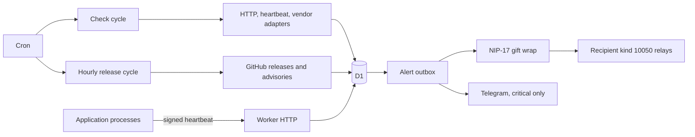

# Architecture

Nostr Watchdog is one Cloudflare Worker and one D1 database per environment. A project is a name, a sender key, and a set of monitors. The check loop, incident policy, and delivery path are the same for every project.

The minute cron runs due probes. The hour cron reads upstream releases and GitHub Security Advisories for monitors that declare a vendor. Both take a D1 lease so an overlapping invocation does not double-send. One failed probe is recorded for that monitor. The others still run.

## State

A check updates `monitor_state` with a generation compare-and-swap. Opening or closing an incident, and inserting the alert rows, happen in the same D1 batch and are conditioned on that new generation. `incidents` allows one open row per monitor. `alert_outbox.dedupe_key` is unique. A lost race does not open a second incident or a second copy of the same alert.

Delivery is at least once. A gift wrap uses a random key, so the signed event is stored on the outbox row before the first publish and a retry sends that same event. Relay `OK` means the relay accepted the event. It does not mean a person or a phone received it. States are `queued`, `relay_accepted`, `retrying`, and `failed`.

## Incidents

The default is two consecutive failures to open and two consecutive successes to close. `down` uses the monitor severity. `degraded` opens a warning incident only when that monitor sets `incidentOnDegraded`. `misconfigured` opens a warning on the first sample. `unknown` does not move the success or failure counters and does not close an incident. A skipped check is not a success. Skips happen when a monitor is disabled, its interval has not elapsed, or another run holds the lease.

Critical outage reminders stay off until `CRITICAL_REMINDER_SECONDS` is set. Reminders are not sent for warning incidents, acknowledged incidents, or incidents inside a silence window.

## Notifications

Each project has its own sender secret and contact name. NIP-17 encryption and gift-wrap construction come from `nostr-tools` (`wrapEvent` / `unwrapEvent`). This Worker does not implement NIP-44 itself.

Inbox relays are the `relay` tags on the recipient's kind `10050` event, discovered through `BOOTSTRAP_RELAYS` and cached. Gift wraps are not sent to the bootstrap relays, to kind `10002` relays, or to any URL that is not `wss` on port 443. If every bootstrap relay answers and none has a valid inbox, delivery fails with `recipient_inbox_missing`. A timeout is retried. It is not treated as an empty inbox.

Telegram is optional and only for critical incidents. When a bot token and a per-project chat id are set, `TELEGRAM_CRITICAL_MODE=dual` sends Telegram alongside NIP-17. `nostr_fallback` sends Telegram only after a NIP-17 attempt fails. A Telegram failure does not stop the Nostr send.

## Vendor adapters

`alby_hub` calls `GET /api/info`, `GET /api/health`, and `GET /api/node/status`. Info is not proof of node health. Health and node status require a read-only token. The shared cloud origin requires a routing profile and hub name headers. An unknown alarm or a body that does not match the expected fields is `unknown`, which neither clears an incident nor opens a critical one.

`btcpay` calls Greenfield `GET /api/v1/health`. Server info is requested only when a separate read-only key is configured, using the `token` authorization scheme. The check does not create invoices. Chain metadata is not copied into alerts.

Release checks compare an observed version with the latest stable GitHub release for `getAlby/hub` or `btcpayserver/btcpayserver`. A security alert is sent only when a published GitHub Security Advisory range includes the installed version, or when a range cannot be applied and a human should review it. An empty advisory list is not a claim that the software is secure.

## Samples

`src/config/projects.ts` and `src/config/monitors.ts` contain disabled sample definitions so the Worker, Wrangler bindings, and tests have a concrete shape. Replace them with your own projects. The samples are not a supported integration with any particular application.
